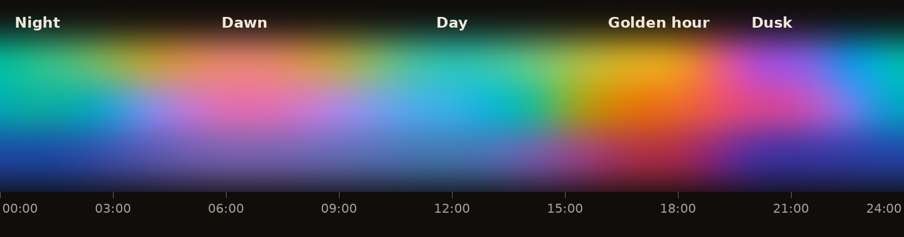
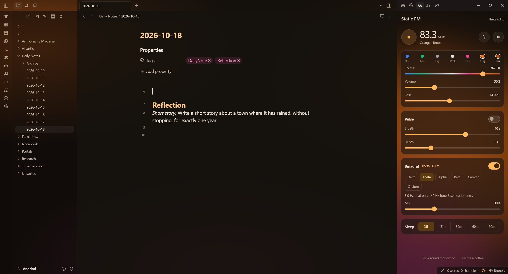

# Aurora Clock

Your Obsidian theme follows the sky. Aurora Clock slowly changes your theme's glow through the day: a soft sunrise in the morning, clear blue skies at midday, warm gold in the late afternoon, violet at dusk, and the green of a real aurora at night.

It was made for the [Static Aurora](https://github.com/AshOtis/aurora-theme) theme, and any theme can use it.



## How it feels

You never see it change. The colours drift a tiny amount each minute, so you only notice later that the room on your screen feels warmer than it did an hour ago, the way daylight changes.

| Time | Mood | Colours |
|---|---|---|
| Around 1am | **Night** | aurora green, deep teal, blue |
| Around 6:30am | **Dawn** | peach, rose, lilac |
| Around noon | **Day** | teal, cyan, sky blue |
| Around 5:30pm | **Golden hour** | amber, orange, coral |
| Around 8:30pm | **Dusk** | violet, magenta, indigo |

Between those times, one mood blends into the next. The blending keeps the in-between colours bright instead of passing through grey or mud.



## With Static Aurora

Install the [Static Aurora](https://github.com/AshOtis/aurora-theme) theme and turn on Aurora Clock. The glow behind your notes and the panels takes on the colours of the time of day.

**With the music players:** if you use [Static FM](https://github.com/AshOtis/static-fm), [Hi-Fi Tuner](https://github.com/AshOtis/hifi-tuner) or [Aurora MP3](https://github.com/AshOtis/aurora-mp3), the music always leads. While one of them is playing, the theme takes the colours of your music. When it stops, Aurora Clock takes over again. You can change this with the **After the music stops** setting.

## Settings

- **Colours follow the time of day:** turn it on or off. There's also a command for this.
- **After the music stops:** go back to the time of day, or keep the music's colours.
- **Preview a whole day:** watch 24 hours go by in 20 seconds. Also a command: **Aurora Clock: Preview a whole day**.

## For theme authors

Aurora Clock works out the time and the colours. Your theme just reads them. The plugin keeps these up to date on `<body>`:

| What | Example | Use it for |
|---|---|---|
| `--clock-c1`, `--clock-c2`, `--clock-c3` | `rgb(251, 191, 36)` | the three colours of the moment: glows, accents, gradients |
| `--clock-hour` | `18.50` | the time as a number from 0 to 24 |
| `clock-night`, `clock-dawn`, `clock-day`, `clock-golden`, `clock-dusk` | `body.clock-dusk` | one class for the current mood |

Some examples:

```css
/* tint your accent with the sky */
body { --interactive-accent: var(--clock-c1, #7c3aed); }

/* purple links at dusk */
body.clock-dusk { --link-color: #a855f7; }

/* dim the background a little as the evening goes on */
body {
  --late: clamp(0, (var(--clock-hour, 12) - 18) / 6, 1);
}
.workspace { filter: brightness(calc(1 - var(--late) * 0.2)); }
```

Always give a fallback (the second value in `var(…, fallback)`), so your theme still looks right for people without the plugin.

Plugins can listen too:

```js
this.registerEvent(this.app.workspace.on('aurora-clock:tick', ({ hour, mood, colours }) => { /* … */ }));
```

## Light on your computer

Aurora Clock does a few small sums once a minute and only updates the theme when the colour change would be visible. It pauses while Obsidian is minimised. It uses no network and reads no files.

## Install

From Obsidian: **Settings → Community plugins → Browse**, search for **Aurora Clock**, then **Install** and **Enable**.

## Support

Made by [AshOtis](https://github.com/AshOtis). If you like it, you can [buy me a coffee](https://buymeacoffee.com/ashotis). Found a bug or have an idea? [Open an issue](https://github.com/AshOtis/Aurora-Clock/issues). It's the best way to reach me, and every report gets read.

## Licence

[MIT](LICENSE)
